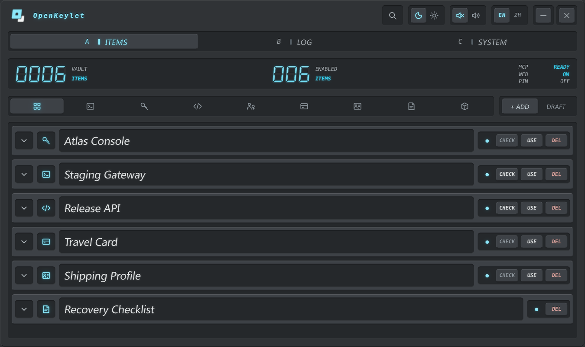
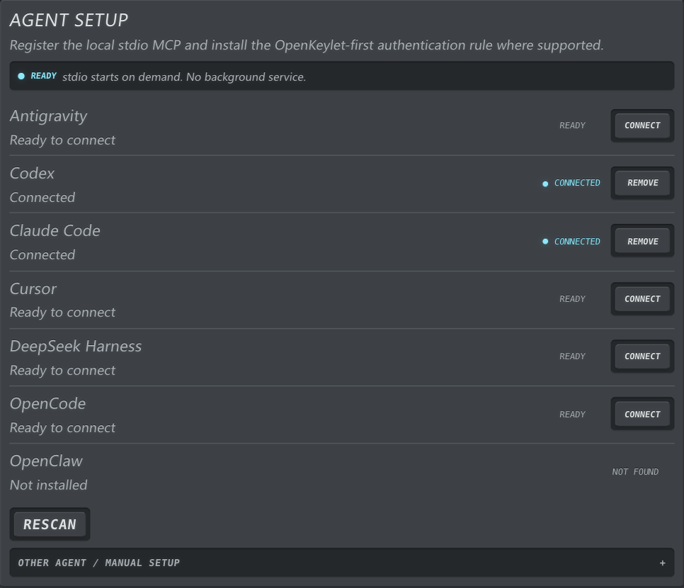
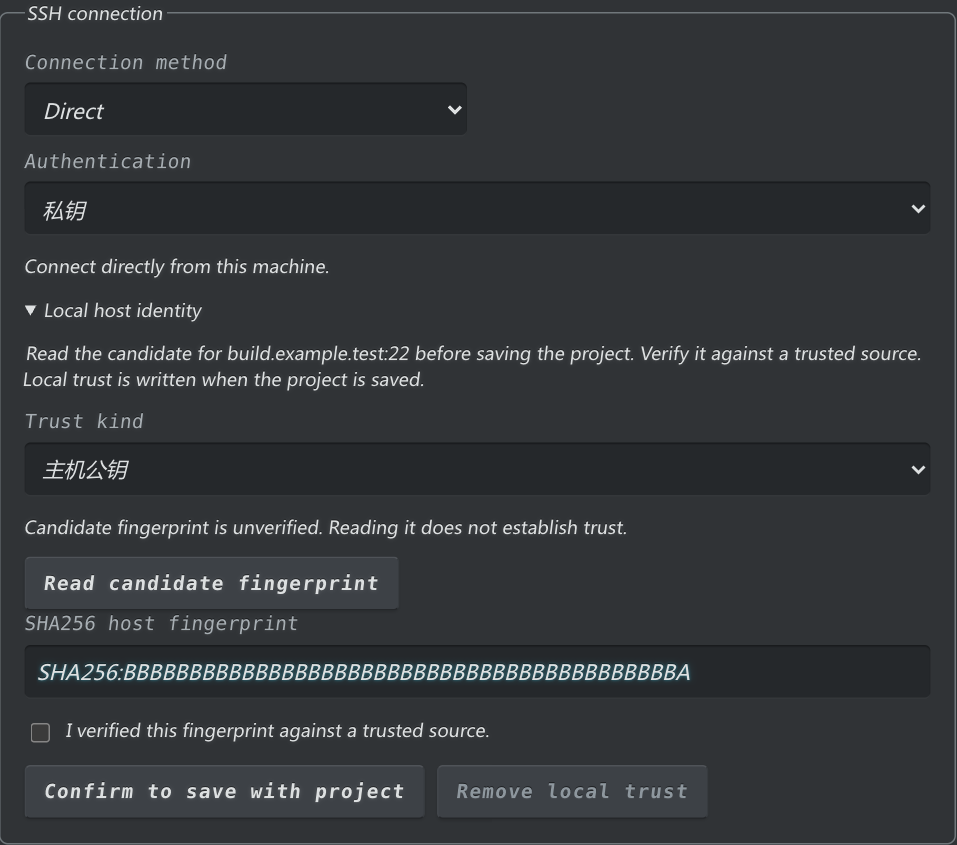

<p align="center">
  
</p>

<h1 align="center">OpenKeylet</h1>

<p align="center"><strong>A local password vault and credential manager for AI agents.</strong></p>

<p align="center">
  <a href="../../releases/latest"><strong>Download</strong></a> ·
  <a href="README.zh-CN.md">简体中文</a> ·
  <a href="#quick-start">Quick start</a> ·
  <a href="SECURITY.md">Security</a>
</p>

OpenKeylet stores passwords, passkeys, SSH keys, API credentials, and one-time code seeds in an encrypted vault on your device. You can use the vault from the desktop app or Chromium extension. An AI agent can also use the credentials through local `stdio` MCP. For example, it can connect to a server, call an API, or fill a login while hidden values stay out of normal MCP responses.

OpenKeylet is free and open source. It runs on Windows, macOS, and Linux without an OpenKeylet account.

## Interface gallery



<table>
  <tr>
    <td width="50%" valign="top">
      <br />
      <strong>Agent setup.</strong> Connect or repair local MCP registrations from Settings.
    </td>
    <td width="50%" valign="top">
      <br />
      <strong>SSH host identity.</strong> Read and verify a candidate fingerprint before saving the project.
    </td>
  </tr>
</table>

The screenshots show the current interface populated with synthetic data.

## Quick start

1. Download and open the [build for your platform](../../releases/latest).
2. Choose **Add** and save a login, SSH project, or API credential. Give the project a unique name.
3. Open **Settings → Agent connection**, select **Connect** for your client, and start a new agent session. Use **Repair** if the registered executable moved.
4. Click **Use** on the project row to copy a reference for your agent, or name the project directly in your request.

Supported setup targets include Antigravity, Claude Code, Codex, Cursor, DeepSeek Harness, OpenClaw, and OpenCode. Other clients can register a local server manually. The MCP process starts on demand.

## Agent examples

Replace the quoted names with projects saved in your vault. The examples use fictional projects, paths, and resources. For steps that require desktop or browser-extension confirmation, the agent can guide you while you review and confirm the action in the interface.

### Find projects and plan actions

| **Task** | **What to ask your agent** |
| --- | --- |
| Find credentials | `Find the OpenKeylet login projects for the demo console and list their names and available actions.` |
| Select a project | `Use "Staging Gateway" in OpenKeylet for SSH checks in this session.` |
| Preview the next call | `Check whether "OCI Read Only" can list instances in the app compartment. Show the next request, required inputs, and how to get the next page. Wait before sending it.` |

### SSH, jump hosts, and file transfer

| **Task** | **What to ask your agent** |
| --- | --- |
| Inspect a server | `Use "Staging Gateway" to check disk usage and nginx status. Report the exit code and stderr.` |
| Connect through a jump host | `Use the saved jump route for "Private Worker" and check the target host's load.` |
| Supply a connection target | `Use "Lab SSH Key" to connect to lab.example.test on port 2222 as deploy and check the OS version.` |
| Pass input to a remote command | `Use "Staging Gateway" to run the remote validation script with this test JSON on stdin and report the result.` |
| Run a sudo command | `Use "Staging Gateway" to check nginx status with sudo -S. Pass the project's sudo password module to sudo on stdin and keep the value hidden.` |
| Inject an environment variable | `Run the deployment preflight through "Staging Gateway" with its saved service token as an environment variable. Keep the token out of the output.` |
| Upload a file or directory | `Use "Staging Gateway" to upload ./dist to /srv/staging/build-42 over SFTP. Keep any existing destination.` |
| Download a file or directory | `Use "Staging Gateway" to download /srv/staging/reports to ./reports over SFTP. Keep any existing local files.` |
| Recover after a disconnect | `Use "Staging Gateway" to check the recorded state of deployment build-42 and the running version. If the result is unknown, wait before resubmitting.` |

SSH uses the project's existing trust settings. Verify fingerprints independently before confirming new or changed host trust on your device.

### API requests and pagination

| **Task** | **What to ask your agent** |
| --- | --- |
| Read GitHub commits | `Use "Release API" to list the latest 20 commits for example-org/demo with their SHA and subject.` |
| List running OCI instances | `Use "OCI Read Only" to resolve the app compartment by name, then list its running instances across all pages.` |
| List AWS EC2 instances | `Use "AWS Sandbox" to list running EC2 instances in its configured region. Follow the next-page token if present.` |
| List Cloudflare DNS records | `Use "DNS Read Only" to find the zone ID for example.test, then list its A and CNAME records.` |
| List DigitalOcean Droplets | `Use "DigitalOcean Lab" to list Droplets across all pages and report each name, region, and status.` |
| List Hetzner Cloud servers | `Use "Hetzner Lab" to list cloud servers across all pages and report each name and status.` |
| Call a general API | `Use "Build API" to query /v1/builds on its saved service with status=failed. Return the HTTP status and structured data.` |
| Send JSON | `Use "Build API" to POST this JSON to /v1/checks on the test service. Return the HTTP status.` |
| Upload a form or attachment | `Use "Build API" to upload ./build-report.json as a multipart attachment to the test reports endpoint.` |
| Save a response to disk | `Use "Build API" to download the build manifest to ./artifacts/manifest.json. Keep any existing file.` |

### Local commands, terminals, and credential fills

| **Task** | **What to ask your agent** |
| --- | --- |
| Run a one-shot command | `Run npm test in the local project through OpenKeylet. Report the exit code, stdout, and stderr.` |
| Inject a secret into a local command | `Run the local test script with BUILD_API_TOKEN from the saved "Build API" module. Return only the test results.` |
| Use a redacted .env template | `Run npm run smoke with the environment variables from the .env template OpenKeylet generated on import. Return only the test results.` |
| Use an interactive terminal | `Start the test login program in an OpenKeylet terminal, wait for the username prompt, fill it, read the result, then close the session.` |
| Fill a browser field | `Fill the focused browser field with the username from "Atlas Console". Leave the form unsubmitted.` |
| Fill and submit a form | `Check that the browser is on the test login page at console.example.test, then fill its focused password field from "Atlas Console" and submit.` |
| Fill a desktop field | `Fill the focused desktop field with the password from "Atlas Console". Leave the form unsubmitted.` |
| Fill a one-time code | `Fill the current OpenKeylet terminal's 2FA prompt with the code from "Atlas Console". Keep the setup seed hidden.` |

Browser and desktop fills use the current target. The agent can fill one field at a time. The extension popup fills the matching login's fields using its website rules.

### Certificates and vault writes

| **Task** | **What to ask your agent** |
| --- | --- |
| Inspect a certificate and signing grants | `Check which CA types and lifetimes OpenKeylet allows. Read the names and expiration of ./certs/lab-server.pem.` |
| Verify a certificate or match a key | `Verify ./certs/lab-server.pem against the test CA and expected hostname. Check whether it matches "Lab TLS" in OpenKeylet. Return only the check results.` |
| Issue an SSH user certificate | `If "Lab SSH CA" is authorized, sign this public key for deploy with a one-hour validity period.` |
| Issue an SSH host certificate | `If "Lab SSH CA" is authorized, issue a one-day SSH host certificate for lab.example.test using the supplied host public key.` |
| Issue a TLS server certificate | `If "Lab TLS CA" is authorized, issue a one-day server certificate for api.example.test from my CSR.` |
| Issue a TLS client certificate | `If "Lab TLS CA" is authorized, issue a one-day TLS client authentication certificate for client.example.test from this CSR.` |
| Inspect vault write permissions | `Check whether OpenKeylet MCP can write to "Demo workspace" and list the permitted operations.` |
| Create or update a project | `If authorized, create "Demo API" in "Demo workspace" using the public service URL I provide. Update "Release API" to describe its read-only release purpose.` |
| Move a project | `If both folders are authorized, move "Demo API" to "Demo Archive" and keep its current fields.` |

Certificate issuance takes a public key or CSR and requires a separate CA grant. MCP vault writes are off by default and require access to the relevant folders. Enter new secret values in the desktop editor.

### Workflows you confirm in the desktop app or extension

| **Task** | **What to ask your agent** |
| --- | --- |
| Import a password vault | `Show me where to preview and import a 1Password 1PUX or CSV, KeePass XML, Bitwarden JSON, or browser CSV export. I'll confirm the import.` |
| Import developer configuration | `Show me where to import .env, OpenSSH configuration, a cURL command, or AWS CLI credentials. For .env, show me where to copy the generated template bound to the imported projects.` |
| Import 2FA from an image | `Guide me through choosing or pasting the QR image for "Atlas Console". I'll check the preview and save it.` |
| Scan a 2FA QR code on a page | `Show me how to scan this page's setup QR in the extension, verify the account, and save it to the matching login.` |
| Save a login or use a passkey | `Show me how to review and save this login in the extension, or confirm a sign-in with my local passkey.` |
| Verify an SSH host fingerprint | `Show me where to read the candidate fingerprint for a new SSH key project. I'll verify it independently and confirm local trust before saving.` |
| Export or import an encrypted backup | `Show me how to export an encrypted .mvault and preview the backup when importing it on another device.` |
| Preview a GitHub backup restore | `Show me how to preview the encrypted snapshot in my private GitHub repository and confirm a merge restore.` |

## What you can do

### Manage passwords, passkeys, and 2FA

Organize logins, cards, identities, secure notes, and custom fields with folders, favorites, and search. Generate passwords, review encrypted password history, and restore items from Trash.

The Chromium extension shares the same vault through the local Browser Bridge. It can fill website logins, cards, and identities, and lets you review a captured login before saving. Website rules scope fills from the extension popup. For supported passkeys, you can register or sign in after confirming the request. The private key stays in the vault.

Import a TOTP setup QR code offline from an image or the clipboard. The extension can also scan a QR code on the page, preview it, and save it to a matching login after confirmation. Fill the current code from that login.

### Connect to servers and run commands

SSH supports passwords, private keys, and user certificates, with a direct connection or a single saved jump project. Each hop uses its own credentials. Agents can run commands with stdin, read the exit code and output, and transfer files and folders with SFTP. If the connection drops without a confirmed command result, OpenKeylet can report that the remote outcome is unknown.

In a new or edited SSH project, open **Local host identity** and read the candidate fingerprint before saving. Verify it against a trusted source, confirm it, then save the project and its local trust together. For an existing project whose route is unchanged, you can update its local trust immediately. [SSH jump hosts](docs/ssh-jump.md) · [Certificate workflows](docs/certificates.md)

### Call APIs and use secrets in local workflows

Use saved credentials in HTTP requests, local commands, and managed terminal sessions. References such as `{{openkeylet:module name}}` are resolved locally. For supported tasks, MCP tools can show the selected project, suggest the next callable request, and explain missing parameters and pagination.

Native workflows cover GitHub commits, OCI compartments and running instances, AWS EC2 running instances, Cloudflare zones and DNS, DigitalOcean Droplets, and Hetzner servers. General HTTP requests cover other APIs. Certificate signing and vault writes require separate owner permissions. [API provider support](docs/api-provider-integration.md) · [MCP vault write permissions](docs/mcp-vault-write-permissions.md)

### Migrate and back up your vault

| Source | What to use |
| --- | --- |
| Other vaults and browsers | Bitwarden JSON, Chrome or Edge CSV, KeePass 2.x XML, and 1Password 1PUX or CSV |
| Developer configuration | `.env`, OpenSSH configuration, cURL commands, and AWS CLI credential profiles |
| Another OpenKeylet device | Password-protected `.mvault` export, or an encrypted snapshot in your own private GitHub repository |

Import previews let you check the contents before writing to the vault. When importing a `.env` file, OpenKeylet can generate a template with project-bound references for the variables saved in that batch. The template contains placeholders in place of the original values.

GitHub backup uses manual encrypted snapshots and a separate recovery key. You can preview a snapshot and confirm a merge restore. If the snapshot changes after preview, refresh the preview before restoring.

## Credential controls

| Control | What it does |
| --- | --- |
| Agent visibility | Hidden modules can be used locally by an enabled project. Making a module visible lets MCP return its value. |
| Item enable switch | Disable a project to stop agents from using it. |
| Local PIN | Locks desktop and extension vault access. Enabled MCP actions can continue while the GUI is locked. |
| SSH host identity | Existing trust records are checked. Jump routes require trusted endpoints. The setting that allows a direct connection without a trust record is off by default. |

The vault encrypts secret fields with XChaCha20-Poly1305. OpenKeylet runs with the permissions of your OS user. An enabled project can perform the actions you give it, including commands on a remote server. Review the [security model](SECURITY.md) before using it with sensitive systems.

## Downloads

| Platform | Package |
| --- | --- |
| Windows x64 | Portable ZIP |
| macOS arm64 | ZIP containing the macOS app |
| Linux x64 desktop | Tar archive containing an AppImage. Desktop input supports X11. |
| Linux x64 headless | Tar archive containing a CLI and MCP executable without a WebView dependency. |

<details>
<summary>Manual MCP configuration, browser setup, and upgrading</summary>

Run one of these commands to print your local MCP configuration:

```text
openkeylet config stdio-json
openkeylet config stdio-toml
```

Configure your client to run `openkeylet mcp stdio` with the absolute path to the installed executable. For Linux without a desktop, see the [headless CLI guide](docs/headless-admin-cli.md).

To use the browser extension, start **Browser Bridge** in Settings and follow the prompts to install and pair the bundled extension. Keep the desktop app and bridge running while using it.

OpenKeylet was previously called KRU. It continues to use the existing local vault and supports legacy `{{kru:module}}` references. After updating from KRU, use **Agent connection → Repair** and start a new agent session.

</details>

## Build from source

Install Rust, Node.js 22+, and the [Tauri platform prerequisites](https://v2.tauri.app/start/prerequisites/). Run `npm ci` to install JavaScript dependencies, `npm test` to run the Rust suite, and `npm run dev` to start the desktop app. See the [release workflow](.github/workflows/release.yml) for platform builds and packaging.

[MIT License](LICENSE)
