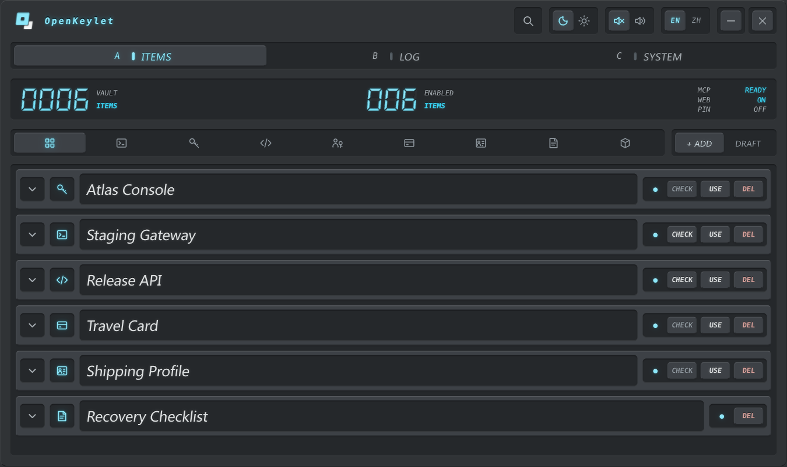
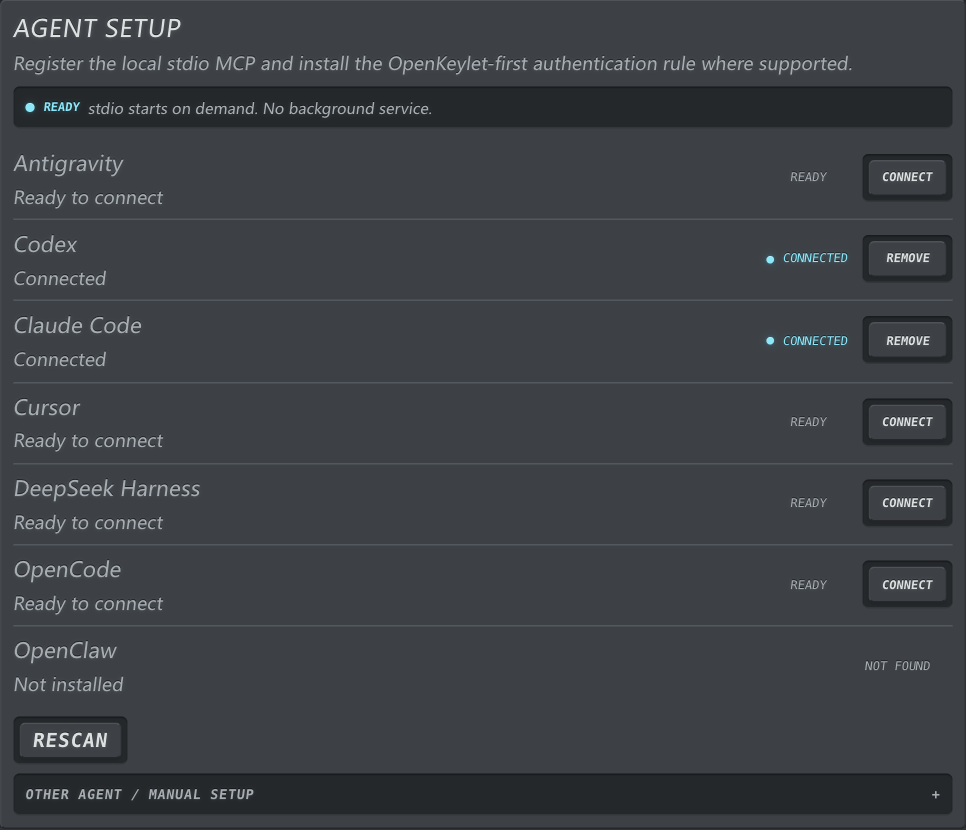
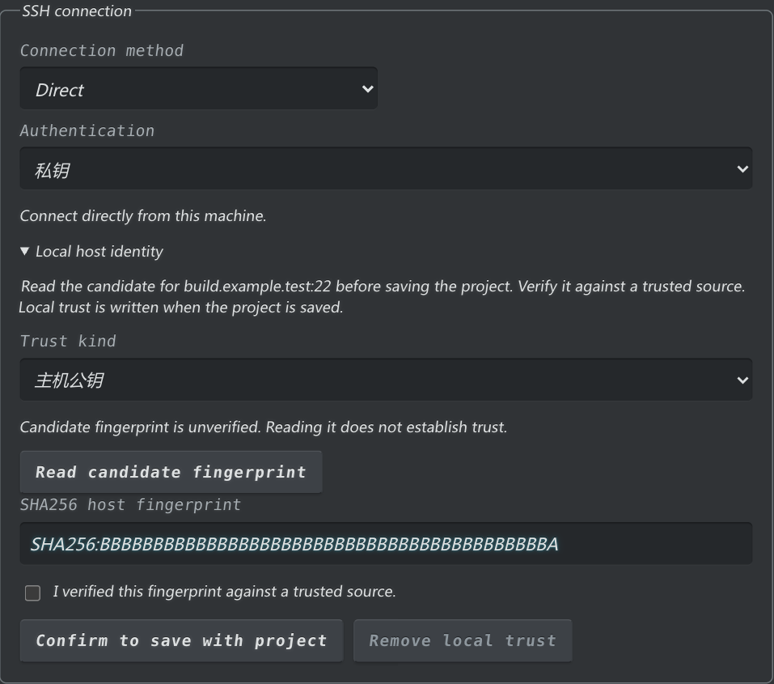

<p align="center">
  
</p>

<h1 align="center">OpenKeylet</h1>

<p align="center"><strong>为 AI Agent 提供本地密码库与凭据管理。</strong></p>

<p align="center">
  <a href="../../releases/latest"><strong>下载</strong></a> ·
  <a href="README.md">English</a> ·
  <a href="#快速开始">快速开始</a> ·
  <a href="SECURITY.zh-CN.md">安全说明</a>
</p>

OpenKeylet 将密码、Passkey、SSH 私钥、API 凭据和一次性验证码种子保存在本机加密库中。你可以在桌面应用和 Chromium 扩展中使用这些凭据，也能通过本地 `stdio` MCP 让 Agent 登录、连接服务器或调用 API。隐藏字段由 OpenKeylet 在本机使用，不会通过正常 MCP 响应返回给 Agent。

OpenKeylet 免费开源，支持 Windows、macOS 和 Linux，无需注册 OpenKeylet 账号。

## 界面预览



<table>
  <tr>
    <td width="50%" valign="top">
      <br />
      <strong>Agent 连接。</strong> 在设置中注册或修复本地 MCP 配置。
    </td>
    <td width="50%" valign="top">
      <br />
      <strong>SSH 主机身份。</strong> 项目保存前即可读取并核对候选指纹。
    </td>
  </tr>
</table>

截图使用当前界面和合成测试数据。

## 快速开始

1. [下载对应平台的版本](../../releases/latest)并打开。
2. 点击 **添加**，保存一个登录、SSH 或 API 项目，并为它起一个唯一的名字。
3. 在 **设置 → Agent 连接** 中点击对应客户端的 **Connect**，然后开启新的 Agent 会话。应用路径变更后可点 **Repair**。
4. 点击项目行上的 **Use** 复制给 Agent 的使用提示，或直接在对话中写出项目名。

支持配置 Antigravity、Claude Code、Codex、Cursor、DeepSeek Harness、OpenClaw 和 OpenCode。其他支持本地 `stdio` MCP 的客户端可以手动配置。MCP 进程按需启动。

## Agent 使用示例

把引号或书名号里的示例名称替换成你保存的项目名。下面的提示词使用虚构的项目、路径和资源。涉及桌面或浏览器扩展确认的操作，Agent 可以给出步骤，由你在界面上核对并确认。

### 查找项目和规划操作

| **要做的事** | **可以这样告诉 Agent** |
| --- | --- |
| 查找凭据 | `在 OpenKeylet MCP 中查找能访问演示控制台的登录项目，列出候选名称和可用操作。` |
| 指定项目 | `本会话使用 OpenKeylet 中的「Staging Gateway」执行后续 SSH 查询。` |
| 预览下一步 | `检查「OCI Read Only」是否能查询 app 区间的实例，给出下一条请求、必填参数来源和分页方式，先不要发请求。` |

### SSH、跳板和文件传输

| **要做的事** | **可以这样告诉 Agent** |
| --- | --- |
| 检查远程主机 | `使用「Staging Gateway」查看磁盘占用和 nginx 运行状态，报告退出码及错误输出。` |
| 通过跳板执行 | `使用「Private Worker」的已保存跳板路径，查看目标主机的负载。` |
| 指定临时连接目标 | `使用「Lab SSH Key」，以 deploy 连接 lab.example.test 的 2222 端口，查看系统版本。` |
| 将数据通过标准输入传入 | `使用「Staging Gateway」执行远端校验脚本，把这段测试 JSON 通过标准输入传给脚本，返回校验结果。` |
| 使用 sudo | `使用「Staging Gateway」通过 sudo -S 查询 nginx 状态。把项目的 sudo 密码模块通过标准输入传给 sudo，不显示密码。` |
| 向远程进程注入凭据 | `使用「Staging Gateway」执行部署预检，把已保存的服务令牌作为环境变量传给脚本，不打印令牌。` |
| 上传文件或目录 | `通过「Staging Gateway」用 SFTP 上传 ./dist 到 /srv/staging/build-42，保留已有目的地。` |
| 下载文件或目录 | `通过「Staging Gateway」用 SFTP 把 /srv/staging/reports 下载到 ./reports，保留已有本地文件。` |
| 确认断线后的任务结果 | `通过「Staging Gateway」只读查询部署 ID build-42 的状态和当前版本；结果未知时先不要重新提交部署。` |

SSH 使用项目的现有信任设置。需要建立或更换主机信任时，请先独立核对指纹，再在本机确认。

### API 调用和分页

| **要做的事** | **可以这样告诉 Agent** |
| --- | --- |
| 查询 GitHub 提交 | `使用「Release API」读取 example-org/demo 的最近 20 条提交，给出 SHA 和提交标题。` |
| 查询 OCI 运行实例 | `使用「OCI Read Only」，先从区间名 app 找到区间 ID，再翻页列出该区间中运行的实例。` |
| 查询 AWS EC2 | `使用「AWS Sandbox」列出已配置区域中正在运行的 EC2 实例，有下一页就继续。` |
| 查询 Cloudflare DNS | `使用「DNS Read Only」找到 example.test 的站点 ID，再列出 A 和 CNAME 记录。` |
| 查询 DigitalOcean | `使用「DigitalOcean Lab」分页列出 Droplets，汇总名称、区域和状态。` |
| 查询 Hetzner Cloud | `使用「Hetzner Lab」分页列出云服务器，汇总名称和运行状态。` |
| 调用通用 API | `使用「Build API」请求已保存服务下的 /v1/builds，按 status=failed 过滤，返回 HTTP 状态和结构化数据。` |
| 发送 JSON | `使用「Build API」向测试服务的 /v1/checks 提交这份 JSON，返回 HTTP 状态。` |
| 上传表单或附件 | `使用「Build API」将 ./build-report.json 作为 multipart 附件上传到测试报告接口。` |
| 将响应保存到文件 | `使用「Build API」下载构建清单到 ./artifacts/manifest.json，保留已有文件。` |

### 本地命令、终端和填写凭据

| **要做的事** | **可以这样告诉 Agent** |
| --- | --- |
| 运行一次本地命令 | `在本机项目目录执行 npm test，报告退出码、标准输出和错误输出。` |
| 为本地命令注入凭据 | `使用「Build API」运行本地测试脚本，从已保存模块注入 BUILD_API_TOKEN，只返回测试结果。` |
| 使用脱敏 .env 模板运行 | `用 OpenKeylet 导入后生成的 .env 模板为 npm run smoke 注入环境变量，只返回测试结果。` |
| 与本地交互程序对话 | `在 OpenKeylet 的托管终端启动测试登录程序，等账号提示后填写，然后读取结果并关闭会话。` |
| 填写浏览器字段 | `使用「Atlas Console」的用户名填写当前聚焦的浏览器输入框，不提交表单。` |
| 填写并提交表单 | `确认当前是 console.example.test 的测试登录页，再用「Atlas Console」的密码填写已聚焦的密码框并提交。` |
| 填写桌面字段 | `使用「Atlas Console」的密码填写当前聚焦的桌面输入框，不提交。` |
| 填写一次性验证码 | `在当前 OpenKeylet 托管终端的验证码提示中，填写「Atlas Console」的当前 2FA 验证码，不输出设置种子。` |

浏览器和桌面填写使用当前目标。Agent 的逐字段填写与扩展弹窗按网站规则填写整组登录字段是两个入口。

### 证书和密码库写入

| **要做的事** | **可以这样告诉 Agent** |
| --- | --- |
| 查看证书和签发权限 | `检查 OpenKeylet 已授权的 CA 类型和有效期上限，解析 ./certs/lab-server.pem 的域名和到期时间。` |
| 验证证书或匹配私钥 | `用测试 CA 公共证书验证 ./certs/lab-server.pem 的签名和主机名，并检查它是否匹配「Lab TLS」中保存的私钥。只返回核对结果。` |
| 签发 SSH 用户证书 | `如果「Lab SSH CA」已获授权，用我提供的公钥为 deploy 签发一小时的 SSH 用户证书。` |
| 签发 SSH 主机证书 | `如果「Lab SSH CA」已获授权，用我提供的主机公钥为 lab.example.test 签发一天的 SSH 主机证书。` |
| 签发 TLS 服务端证书 | `如果「Lab TLS CA」已获授权，从我提供的 CSR 为 api.example.test 签发一天的服务端证书。` |
| 签发 TLS 客户端证书 | `如果「Lab TLS CA」已获授权，从这份 CSR 为 client.example.test 签发一天的 TLS 客户端认证证书。` |
| 查询密码库写入权限 | `检查 OpenKeylet MCP 是否可以写入「Demo workspace」，只列出允许的操作。` |
| 创建或修改项目 | `如果已授权，在「Demo workspace」创建「Demo API」，填写我提供的公开服务地址；再把「Release API」的公开用途改为只读发布查询。` |
| 移动项目 | `如果源文件夹和目标文件夹都已授权，将「Demo API」移到「Demo Archive」，保留现有字段。` |

证书签发使用公钥或 CSR，要求单独的 CA 授权。MCP 写入默认关闭，须按文件夹授权。新增凭据不必贴到对话，可在桌面编辑器中录入。

### 由你在桌面或扩展确认的流程

| **要做的事** | **可以这样告诉 Agent** |
| --- | --- |
| 导入密码库 | `告诉我如何在 OpenKeylet 中预览并导入 1Password 1PUX、KeePass XML、Bitwarden JSON 或浏览器 CSV，由我确认。` |
| 导入开发配置 | `告诉我在哪里导入 .env、OpenSSH 配置、cURL 命令或 AWS CLI 凭据。导入 .env 后，我还要复制绑定到本批项目的脱敏模板。` |
| 从图片导入 2FA | `指导我在「Atlas Console」的编辑器中选取或粘贴二维码图片，核对预览后保存。` |
| 扫描网页内的 2FA | `告诉我如何在扩展里扫描当前网页上的设置二维码，核对账户后保存到匹配的登录项目。` |
| 保存登录或使用 Passkey | `告诉我如何在浏览器扩展里审核并保存当前登录，或者用本地 Passkey 完成网站确认。` |
| 核对 SSH 指纹 | `指导我在新建 SSH 私钥项目的编辑器中读取候选指纹。我会用独立来源核对，再确认并保存本机信任。` |
| 导出或导入加密备份 | `告诉我如何导出加密 .mvault，并在另一台设备导入和预览备份内容。` |
| 预览 GitHub 备份恢复 | `告诉我如何预览私有 GitHub 仓库里的加密快照并确认合并恢复。` |

## 能做什么

### 管理密码、Passkey 和双重验证

用文件夹、收藏和搜索整理登录、信用卡、身份资料、安全笔记以及自定义字段。可以生成密码、查看加密保存的密码历史，以及从回收站恢复项目。

Chromium 扩展通过本地浏览器桥接使用同一个密码库。它可以填充网站登录、信用卡和身份资料，也可以在保存前让你审核捕获的登录信息。扩展弹窗按照网站匹配规则填充。支持的 Passkey 可在确认后创建或用于登录，私钥保存在密码库中。

可从本地图片或剪贴板离线导入 2FA 设置二维码。扩展也能扫描当前页面上的二维码，预览并确认后保存到匹配的登录项目，再自动填充当前验证码。

### 连接服务器和执行命令

SSH 支持密码、私钥和用户证书。可以直连，也可以指定一个已保存的跳板项目，每一跳使用自己的凭据。Agent 可以通过 SSH 执行命令、传入标准输入、读取退出码和输出，以及通过 SFTP 传输文件和目录。命令可能已经启动但连接中断时，OpenKeylet 可以报告远端结果未知。

新建或修改 SSH 项目时，打开 **本机主机身份信任**，保存前即可读取候选指纹。通过可信来源核对并确认后，保存项目会一并写入本机信任。已有项目的连接路径未变时，可立即更新本机信任。[SSH 跳板](docs/ssh-jump.md) · [证书工作流](docs/certificates.md)

### 调用 API 和在本地使用凭据

已保存的凭据可用于 HTTP 请求、本地命令和托管终端。OpenKeylet 在本机解析 `{{openkeylet:模块名}}` 引用。支持的 MCP 工作流会显示实际选用的项目、下一条可调用的请求，以及缺少的参数和分页方式。

原生工作流覆盖 GitHub 提交、OCI 区间与运行实例、AWS EC2 运行实例、Cloudflare 站点与 DNS、DigitalOcean Droplets 和 Hetzner 服务器。其他 API 可走通用 HTTP。证书签发和密码库写入需要单独授权。[API 支持](docs/api-provider-integration.md) · [MCP 密码库写入权限](docs/mcp-vault-write-permissions.md)

### 迁移和备份密码库

| 数据来源 | 支持方式 |
| --- | --- |
| 其他密码库与浏览器 | Bitwarden JSON、Chrome 或 Edge CSV、KeePass 2.x XML、1Password 1PUX 或 CSV |
| 开发工具配置 | `.env`、OpenSSH 配置、cURL 命令、AWS CLI 凭据配置 |
| 另一台 OpenKeylet 设备 | 受密码保护的 `.mvault` 导出，或自己私有 GitHub 仓库中的加密快照 |

写入前可以预览导入内容。导入 `.env` 后，可以为本批实际保存的变量生成绑定到对应项目的模板，模板用占位符代替原始值。

GitHub 备份采用手动加密快照和独立恢复密钥。恢复前可以预览，确认后合并。若云端快照已变更，需要重新预览。

## 凭据控制

| 控制项 | 作用 |
| --- | --- |
| Agent 可见性 | 已启用项目的隐藏模块可供 OpenKeylet 在本机使用。开启模块可见性后，MCP 可以返回该模块的值。 |
| 项目启用开关 | 停用项目后，Agent 无法使用它。 |
| 本机 PIN | 锁定桌面和扩展的密码库访问。桌面锁定时，已启用的 MCP 操作仍可继续。 |
| SSH 主机身份 | 已有信任记录会参与校验，跳板路径要求信任各端点。允许直连未信任主机的开关默认关闭。 |

密码库使用 XChaCha20-Poly1305 加密秘密字段。OpenKeylet 以当前操作系统用户的权限运行，已启用的项目可以执行所请求的操作，包括在远端执行命令。使用敏感系统前，请阅读[安全边界](SECURITY.zh-CN.md)。

## 下载

| 平台 | 软件包 |
| --- | --- |
| Windows x64 | 便携 ZIP |
| macOS arm64 | 包含 macOS 应用的 ZIP |
| Linux x64 桌面版 | 包含 AppImage 的 tar 包，桌面输入支持 X11 |
| Linux x64 Headless | 包含 CLI 和 MCP 程序的 tar 包，无 WebView 依赖 |

<details>
<summary>手动配置 MCP、连接浏览器和升级旧版</summary>

执行以下任一命令获取本机 MCP 配置：

```text
openkeylet config stdio-json
openkeylet config stdio-toml
```

在客户端配置中使用已安装程序的绝对路径，参数设为 `mcp stdio`。无桌面的 Linux 环境可参考 [Headless CLI 指南](docs/headless-admin-cli.md)。

使用浏览器扩展时，在设置中启动 **浏览器桥接**，根据提示安装并配对随应用提供的扩展。使用期间保持桌面程序和桥接运行。

OpenKeylet 以前叫 KRU。新版继续使用原有本地保险库，并支持旧版 `{{kru:模块名}}` 引用。从 KRU 升级后，可在 **Agent 连接** 点 **Repair**，然后开启新的 Agent 会话。

</details>

## 从源码构建

安装 Rust、Node.js 22+ 和 [Tauri 平台依赖](https://v2.tauri.app/start/prerequisites/)。运行 `npm ci` 安装 JavaScript 依赖，`npm test` 运行 Rust 测试，`npm run dev` 启动桌面应用。各平台的打包步骤见[发布工作流](.github/workflows/release.yml)。

[MIT 许可证](LICENSE)
